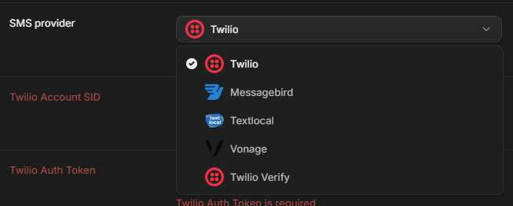

# 🍽️ Porsi Kita



> **“Satu menu keluarga, gizi tepat untuk setiap anggota.”**

Porsi Kita adalah aplikasi web mobile-first yang membantu keluarga Indonesia menyusun menu mingguan yang hemat, aman dari alergi, dan **tepat gizi untuk setiap anggota keluarga**. Ibu memasak satu menu untuk seluruh keluarga, sementara porsi dan kecukupan gizi dihitung terpisah untuk tiap anggota: anak usia 2 tahun ke atas, remaja, ibu hamil atau menyusui, dewasa, dan lansia.

---

## 🌟 Nilai Utama & Jawaban untuk Juri

| Pertanyaan Kunci | Pendekatan Porsi Kita |
| :--- | :--- |
| **Bedanya dengan meal planner lain?** | Gizi dihitung per anggota dari satu masakan keluarga yang sama, dan menu disusun terkunci dalam batas budget harian ibu. |
| **Seberapa akurat?** | Semua angka berasal dari TKPI 2017 (Kemenkes) dan AKG (Permenkes 28/2019), dihitung fungsi TypeScript murni tanpa tebakan AI. 100% unit test lulus. |
| **Apakah datanya bisa dipercaya?** | Dataset divalidasi 4 lapis lewat skrip `validate:data` (format, integritas relasi, kewajaran Atwater 4P+4K+9L, batas retinol). |
| **Apakah data anak aman?** | Prinsip Data Minimal: hanya alias dan usia dalam tahun. Tanpa nama lengkap, tanpa tanggal lahir, tanpa foto/lokasi. Dilindungi RLS Postgres. |

---

## 🛠️ Tech Stack & Arsitektur

- **Framework:** Next.js (App Router) + TypeScript Strict
- **Styling:** Tailwind CSS (Mobile-First, target sentuh ≥ 44px)
- **Mesin Gizi:** Pure TypeScript Engine (`lib/nutrition/` & `lib/planner/`)
- **Basis Data & Auth:** Supabase (PostgreSQL dengan Row Level Security)
- **Validasi:** Zod schemas
- **Pengujian:** Vitest (27 unit tests lulus)
- **Data Ground Truth:** TKPI 2017, Permenkes 28/2019, Snapshot Harga PIHPS BI / Bapanas

### Struktur Direktori

```text
├── app/
│   ├── layout.tsx                      # Root layout dengan Navbar & Disclaimer Wajib
│   ├── page.tsx                        # Beranda & preview interaktif
│   ├── mulai/page.tsx                  # Onboarding 3 langkah (tujuan, data, disclaimer)
│   ├── masuk/page.tsx                  # Autentikasi Masuk & Mode Demo Cepat
│   ├── daftar/page.tsx                 # Pendaftaran akun baru
│   ├── keluarga/                       # Profil keluarga & budget harian
│   │   ├── page.tsx                    # Ringkasan keluarga & daftar anggota
│   │   └── anggota/
│   │       ├── baru/page.tsx           # Tambah anggota (validasi Zod, batas usia < 2 th)
│   │       └── [id]/page.tsx           # Ubah & hapus anggota
│   ├── menu/
│   │   ├── page.tsx                    # Rencana menu 7 hari (kartu harian & skor)
│   │   └── [id]/hari/[n]/page.tsx      # Detail hari, takaran porsi, transparansi gizi & swap
│   ├── resep/[kode]/page.tsx           # Detail resep, gram bahan, nilai gizi, alergen
│   ├── belanja/[id]/page.tsx           # Daftar belanja 7 hari (faktor BDD) & tombol WhatsApp
│   ├── tentang/page.tsx                # Metodologi, sumber data TKPI/AKG, batasan produk
│   ├── panduan/page.tsx                # Panduan penggunaan & tips hemat gizi seimbang
│   └── privasi/page.tsx                # Kebijakan privasi & perlindungan data anak
├── components/
│   ├── Navbar.tsx                      # Navigasi responsif
│   └── Footer.tsx                      # Footer dengan teks disclaimer resmi PRD
├── data/                               # CSV sumber TKPI, AKG, Resep, Harga
├── lib/
│   ├── types.ts                        # Definisi tipe TypeScript
│   ├── schemas.ts                      # Skema validasi Zod
│   ├── store.ts                        # Local state & sinkronisasi demo
│   ├── data/dataset.ts                 # Dataset kompilasi TKPI & AKG
│   ├── nutrition/                      # Mesin gizi (akg, recipe, portions, score, safety)
│   ├── planner/                        # Menu generator, cost, rules, swap
│   └── supabase/                       # Supabase SSR client & server helpers
├── middleware.ts                       # Middleware proteksi rute & session cookie
├── scripts/
│   └── validate_data.mjs               # Skrip validasi data 4 lapis
├── supabase/migrations/
│   └── 001_initial_schema.sql          # Skema tabel & kebijakan RLS
└── tests/
    ├── nutrition.test.ts               # Unit test mesin gizi (17 kasus)
    ├── planner.test.ts                 # Unit test generator & 3 profil PRD (6 kasus)
    └── data_validation.test.ts         # Unit test validasi data 4 lapis (4 kasus)
```

---

## 🚀 Cara Menjalankan

### 1. Prasyarat
- Node.js versi 18+ (atau v20+)
- npm / pnpm

### 2. Instalasi Dependensi
```bash
npm install
```

### 3. Konfigurasi Environment (`.env.local`)
Salin file `.env.example` menjadi `.env.local`:
```bash
NEXT_PUBLIC_SUPABASE_URL="https://hraspfuwergplhxfwtpd.supabase.co"
NEXT_PUBLIC_SUPABASE_PUBLISHABLE_KEY="sb_publishable_..."
```
*(Catatan: Aplikasi tetap memiliki Mode Demo Cepat interaktif bahkan jika offline).*

### 4. Menjalankan Unit Test (27 Test Cases)
```bash
npm test
```

### 5. Menjalankan Validasi Data (4 Lapis)
```bash
npm run validate:data
```

### 6. Menjalankan Server Pengembangan
```bash
npm run dev
```
Buka browser pada [http://localhost:3000](http://localhost:3000).

### 7. Build Produksi
```bash
npm run build
```

---

## 🧪 3 Profil Uji Tetap (PRD Bagian 9 & 17)

1. **Keluarga A (Ibu 32, Ayah 35, Anak 3 th, Anak 8 th):**
   - Menghasilkan menu 7 hari seimbang.
   - Aturan keamanan terbukti: Menu hati ayam dilarang dijadwalkan karena ada balita usia 3 tahun.
2. **Keluarga B (Ibu hamil trimester 2 usia 28, Anak 5 th, Nenek 68 th):**
   - Mendapat tambahan kalori (+300 kkal), zat besi (+9 mg), kalsium (+200 mg) sesuai AKG hamil T2.
3. **Keluarga C (Orang tua tunggal + Remaja putri 12 th, alergi telur):**
   - 100% menu mingguan bebas dari alergen telur (misal telur dadar RSP005 dieksklusi).

---

## ⚖️ Batasan Produk & Disclaimer

- **Bukan Pengganti Medis:** Porsi Kita adalah alat bantu perencanaan menu, bukan pengganti saran dokter atau ahli gizi.
- **Batasan Usia:** Belum mendukung bayi di bawah 2 tahun (MPASI).
- **Standar AKG:** Dihitung berdasarkan berat badan standar populasi nasional (Permenkes 28/2019), bukan berat badan aktual.
